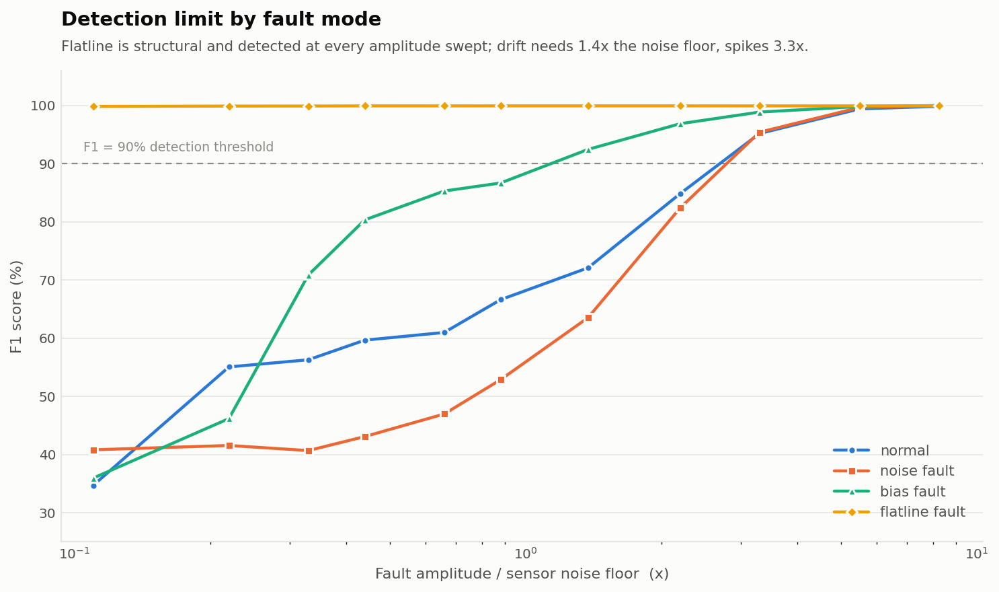
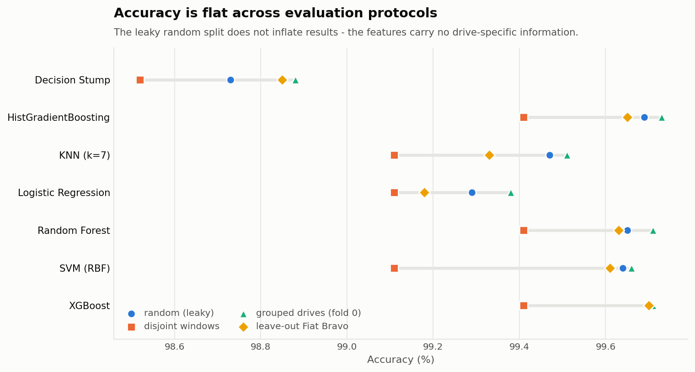
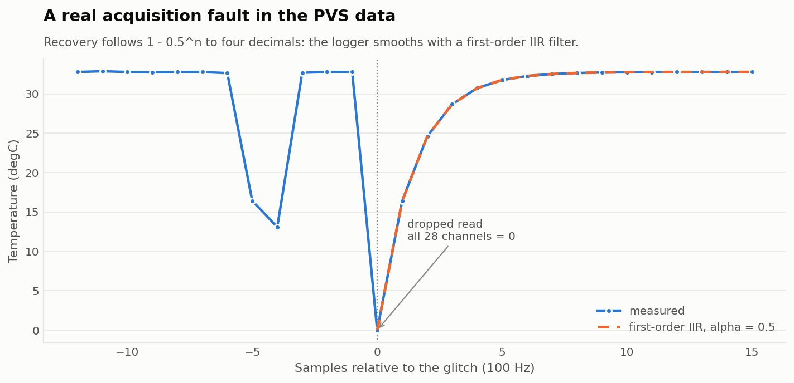

# Sensor Fault Detection in Automotive IMU Sensors

**Detecting faults in the MPU-9250 thermometer channel of a moving vehicle — and measuring how small a fault has to get before detection fails.**


---

## What this is

A faulty IMU feeds bad data into braking, steering and lane-keeping. This project
trains classifiers to tell a healthy sensor window from three fault modes
(spike, drift, flatline) using **6 hours of real driving data** from the
[PVS dataset](https://www.kaggle.com/datasets/jefmenegazzo/pvs-passive-vehicular-sensors-datasets)
— 3 vehicles, 3 drivers, 3 road scenarios, MPU-9250 at 100 Hz.

It began as a course project (v1). Rebuilding it as a tested package meant
auditing three things I suspected were wrong. **One of them invalidated v1's
headline result. The other two turned out to be false alarms** — and are written
up as false alarms, because a negative result you went looking for is worth more
than a positive one you assumed.

| # | Hypothesis | Verdict |
|---|---|---|
| 1 | `unique_ratio` was measuring the injection, not the fault | **Confirmed — v1's result does not survive it** |
| 2 | 50%-overlapping windows inflate accuracy via leakage | Refuted — 96.1% overlap, ≤0.14 pt effect |
| 3 | Correlation pruning discarded the best spike detectors | Mostly refuted — +0.43 pt for linear models, ~0.04 for trees |

---

## Headline result

Under **leave-one-vehicle-out** — train on two vehicles, test on a car the model
has never seen — averaged over all three folds:

| Model | Accuracy | F1 macro | Balanced acc. | Std across folds |
|---|---|---|---|---|
| **XGBoost** | **99.69%** | **99.68%** | 99.68% | ±0.02 |
| HistGradientBoosting | 99.67% | 99.67% | 99.67% | ±0.03 |
| Random Forest | 99.64% | 99.64% | 99.63% | ±0.02 |
| Logistic Regression | 99.29% | 99.28% | 99.28% | ±0.12 |
| Decision Stump (depth 3) | 98.84% | 98.85% | 98.84% | ±0.08 |
| Majority baseline | 24.95% | 9.98% | 25.00% | ±0.51 |

**A depth-3 decision stump gets 98.8%.** That is the most important number in
the table: at the fault amplitudes this task uses, the problem is nearly linearly
separable, and a headline accuracy alone would be close to meaningless. Which is
why the actual deliverable is the curve below, not the number above.

### The result that means something: the detection limit



Accuracy is a function of how large you make the injected faults — a free
parameter. So instead of quoting one number, this sweeps fault amplitude against
the sensor's own noise floor and reports where detection breaks down.

The sensor's own within-window noise floor is **105 mK**. Smallest fault still
detected at F1 ≥ 90%, held-out vehicle:

| Fault mode | Fault / noise floor | Amplitude | Character |
|---|---|---|---|
| **flatline** | **0.11×** | **12 mK** | structural — detected at every amplitude swept |
| **bias / drift** | **1.38×** | **145 mK** | integrates over the window, so it beats the noise early |
| **noise / spike** | **3.30×** | **348 mK** | single-sample events, hardest to separate from noise |

Three distinct behaviours, and each is explainable from the physics rather than
from the model:

- **Flatline** is not amplitude-dependent at all. A stuck sensor has zero
  variance no matter how "large" the fault is, so it stays at ~99.9% F1 even at
  a ninth of the noise floor. It is a change in *kind*, not degree.
- **Drift** is detected at 145 mK because a ramp accumulates across all 100
  samples — the `trend` feature integrates it, and integration beats noise.
- **Spikes** need 348 mK, ~2.4× more, because 3–7 isolated samples give the
  window statistics far less to work with.

Overall accuracy falls from 99.9% to 52.9% across the swept range. **Any single
accuracy figure for this task is really a statement about the injected fault
amplitude**, which is why the curve is the deliverable.

---

## What changed in v2

### 1. `unique_ratio` was detecting the injection procedure, not the fault

**This one invalidated v1's headline result.** v1 reported flatline at a perfect
100% F1, attributing it to `unique_ratio` being "definitive". It was definitive —
but not for the stated reason.

A real MPU-9250 thermometer is **quantised**: a 100-sample window contains only
~16 distinct values. v1 added continuous Gaussian noise to every class *except*
flatline, which pushed those classes to ~99 distinct values while flatline stayed
discrete. `unique_ratio` therefore separated **"was synthetic noise added"** from
"was it not" — a property of the pipeline, not of the sensor.

Raw data sits at `unique_ratio` ≈ **0.160**. Under v1's recipe the injected
classes sit at **0.990** and flatline at 0.570 — so the feature separates the
*recipe*, not the sensor:

| `unique_ratio` (median) | v1 recipe | v2 recipe | raw real data |
|---|---|---|---|
| `normal` | 0.990 | **0.160** | **0.160** |
| `noise_fault` | 0.990 | 0.200 | — |
| `bias_fault` | 0.990 | 0.260 | — |
| `flatline_fault` | 0.570 | 0.010 | — |

**The consequence.** Both recipes look excellent on their own held-out vehicle.
Then each is asked to score 4,230 windows of **raw, untouched, healthy** sensor
data, where the only correct answer is `normal`:

| Recipe | F1 macro | F1 flatline | Raw data called `normal` | Called `flatline_fault` |
|---|---|---|---|---|
| v1 — Gaussian noise, no quantisation | 99.50% | **100.00%** | **0.1%** | **99.8%** ❌ |
| v2 — no added noise, grid-preserving | 99.69% | 99.88% | **98.8%** | 0.2% ✅ |

The v1 column reproduces the original report's perfect 100.00% flatline F1
exactly — and that same model calls 99.8% of a healthy sensor broken. A model can
be near-perfect on its own test set and still be measuring nothing.

Fixed by (a) snapping every injected window back onto the sensor's measured
quantisation grid (0.02396 °C), and (b) dropping the synthetic noise entirely —
the real signal already carries its own, so adding more double-counted it.

Reproduce with [`experiments/05_v1_artifact.py`](experiments/05_v1_artifact.py);
guarded by [`tests/test_faults.py`](tests/test_faults.py)
(`test_normal_class_preserves_source_discreteness`, `test_every_fault_mode_stays_on_the_grid`).

### 2. The data leaks — and it does not matter



v1 split with `train_test_split(X, y, stratify=y)` over windows generated at 50%
overlap. Audited:

| Protocol | Test windows | Drives shared with train | Test windows overlapping train |
|---|---|---|---|
| `random` (v1) | 8,642 | 18 | **96.1%** |
| `disjoint` | 337 | 18 | 0% |
| `grouped` (whole drives held out) | 9,316 | 0 | 0% |
| `vehicle` (leave-one-vehicle-out) | 14,496 | 0 | 0% |

96.1% of v1's test set overlapped its training set. I expected that to have
inflated the result substantially. **It did not** — the spread across all four
protocols is ≤0.14 points for every model.

The reason is that all 16 features are *within-window* statistics. They carry no
drive-specific, vehicle-specific or road-specific information, so there is nothing
for the model to memorise across a leaky boundary. A negative result, kept because
it is the honest one — and because "I audited for leakage and proved it was
harmless" is a stronger claim than assuming either way.

The strict protocols remain the default (`sfd train --protocol vehicle`).

### 3. Correlation pruning cost nothing — except for linear models

v1 computed 13 features, dropped any with |r| > 0.90, and kept 8 — removing
`max_diff` and `mean_abs_diff`, the two statistics that isolate an impulsive
spike. Ablated over leave-one-vehicle-out:

F1 macro, mean over the three leave-one-vehicle-out folds:

| Model | v1's 8 features | + spike detectors | Full 16 | Gain |
|---|---|---|---|---|
| Logistic Regression | 98.86 | 99.20 | 99.28 | **+0.43** |
| XGBoost | 99.64 | 99.65 | 99.68 | +0.05 |
| Random Forest | 99.60 | 99.64 | 99.63 | +0.04 |
| HistGradientBoosting | 99.64 | 99.66 | 99.67 | +0.03 |

I expected this to be the big win — v1's worst confusion was exactly the
normal↔noise boundary that `max_diff` exists to resolve. It is not: tree
ensembles reconstruct that information from `min`/`max`/`std` through splits, so
pruning costs them ~0.04 points. Only the linear model benefits meaningfully
(+0.43), because it cannot build the interaction itself.

The lesson is about the *rule*, not the size of the effect: correlation measures
**marginal** redundancy, not conditional usefulness to a non-linear model, so
"drop anything with |r| > 0.90" is not a model-independent decision. Here it
happened to be nearly free. It was not safe by construction.

---

## A real fault, found in the data



While computing signal statistics, 15 samples across the corpus read exactly
`0.0`. They are not temperatures — and not a thermometer fault: **all 28 channels
go to zero on the same row**, which is a whole-module read failure (I²C), not a
sensor failure.

The recovery is the interesting part. It follows `1 − 0.5ⁿ` to four decimal
places:

| n after glitch | 0 | 1 | 2 | 3 | 4 | 5 |
|---|---|---|---|---|---|---|
| measured / steady | 0.0000 | 0.5000 | 0.7500 | 0.8750 | 0.9375 | 0.9687 |
| `1 − 0.5ⁿ` | 0.0000 | 0.5000 | 0.7500 | 0.8750 | 0.9375 | 0.9688 |

So the logger smooths with a **first-order IIR filter, α = 0.5**, and a dropped
read propagates as a decaying transient over ~5 samples. This also explains why
the channel's effective quantisation step (0.02396 °C) is a clean multiple of the
MPU-9250's 0.002995 °C LSB — the filter puts values on a dyadic sub-grid.

---

## Quickstart

```bash
git clone https://github.com/sm25mtech11008-beep/sensor-fault-detection-imu
cd sensor-fault-detection-imu
pip install -e ".[dev]"

bash scripts/download_pvs.sh     # ~1.1 GB, no login required

sfd stats                        # per-channel signal statistics
sfd audit                        # quantify leakage per protocol
sfd train --protocol vehicle     # train, evaluate, persist
sfd predict --input /path/to/dataset_mpu_left.csv
```

The dataset location comes from `$PVS_DATA` (default `C:\PVS_Dataset`), set in
**one** place — [`src/sfd/config.py`](src/sfd/config.py). v1 hardcoded it in six
(five notebooks plus `scripts/generate_report.py`).

### Getting the data

The Kaggle URL in v1's README is dead (the owner slug is `jefmenegazzo`, not
`jmenegazzo`). The authors also mirror the dataset at
[UFSC](https://arquivos.ufsc.br/d/55ee83c2c9d647eaa252/), which needs **no login
and no API token** — that is what `scripts/download_pvs.sh` uses. It fetches only
the CSVs (~1.1 GB) and skips the video files, which are ~48 GB and unused.

---

## Reproducing the results

```bash
python experiments/01_leakage_study.py     # protocol comparison + leakage audit
python experiments/02_feature_ablation.py  # v1's 8 features vs the full 16
python experiments/03_detection_limit.py   # the headline sweep
python experiments/04_figures.py           # all figures
python experiments/05_v1_artifact.py       # reproduce the v1 bug, then the fix
```

`05` is the one to run if you only run one: it trains both the v1 and the v2
injection recipe, shows they score almost identically on their own test sets,
then scores each against raw healthy data — where only one survives.

Every experiment writes CSVs to `results/experiments/`. Datasets are cached by a
hash of the recipe, so re-runs skip the 20-second rebuild; bump `recipe` in
[`pipeline.py`](src/sfd/pipeline.py) when injection or feature semantics change.

---

## Design

```
src/sfd/
├── config.py     Paths, dataset metadata, windowing. Single source of truth.
├── data.py       Loading, sliding windows, signal statistics (incl. the LSB).
├── faults.py     7 fault models, calibrated in units of the measured noise floor.
├── features.py   16 time-domain features, fully vectorised (~60k windows/s).
├── splits.py     4 evaluation protocols + a leakage auditor.
├── models.py     8 models, each in a Pipeline so scaling is fit per fold.
├── evaluate.py   Metrics, per-class F1, confusion.
├── pipeline.py   Window -> inject -> featurise, with caching.
├── plots.py      Figures.
└── cli.py        stats / audit / train / predict
```

Decisions worth noting:

- **Scaling lives inside the `Pipeline`.** v1 built scaled matrices once, outside
  the CV loop, which leaks test statistics into every fold.
- **Fault severity is decoupled from the noise floor.** Scaling both together
  would rescale the whole problem and leave difficulty unchanged — the severity
  knob has to move the fault-to-noise *ratio* to be an experimental axis at all.
- **Faults are calibrated to within-window σ (0.105 °C), not global σ (3.77 °C).**
  Global σ is dominated by 20-minute warm-up drift; using it made v1's injected
  faults ~32× larger than natural in-window variation.
- **Baselines are in the model zoo**, not an afterthought. The majority classifier
  and the depth-3 stump are what make the ensemble numbers interpretable.

### Three temperature channels, not one

The MPU-9250 exposes `temp_dashboard`, `temp_above_suspension` and
`temp_below_suspension`. v1's auto-detect took the first column matching `temp`
and silently discarded the other two. All three are available via
`--channel`; `temp_above_suspension` is the default (largest dynamic range).

---

## Honest limitations

- **Faults are synthetic.** The PVS dataset contains no labelled sensor faults, so
  they are injected. The 15 real glitches found above are the only genuine faults
  here, and there are far too few to train on. Every number in this README is
  conditional on the injection model being realistic — which is exactly why the
  detection-limit curve is reported instead of a single accuracy.
- **`normal` is real, faults are not.** After the v2 fix the healthy class is
  untouched real data, which is a meaningful improvement over v1 (where both
  classes were synthesised), but the fault classes remain modelled.
- **One sensor modality.** Only the thermometer is used. The 24 accelerometer,
  gyroscope and magnetometer channels are loaded but unmodelled — the obvious
  next step, and cross-channel consistency would catch the whole-module failures
  that a single-channel detector cannot.
- **No temporal model.** Each window is classified independently; a real
  diagnostic would persist state across windows and require N consecutive
  detections before flagging.

---

## Testing

```bash
pytest                    # 34 tests
ruff check src tests experiments
```

Tests pin the things that would silently corrupt results: the closed-form trend
matches `np.polyfit` to machine precision, every fault mode produces the signature
it claims, each split protocol leaks exactly as much as it should, and the
quantisation regression above.

---

## Team & provenance

Original class project — **Automotive Communication and Sensing**, IIT Hyderabad:
NCSS Uday (SM25mtech11002), Shashi Prakash (SM25mtech11008),
Bavan Prabahar (SM25mtech11009).

The v1 notebooks are preserved in [`notebooks/`](notebooks/) with a
[README](notebooks/README.md) mapping each to its replacement. The original report
is at [`docs/Project_Report_Final.pdf`](docs/Project_Report_Final.pdf).

## References

1. J. Menegazzo, A. von Wangenheim, *"Multi-Contextual and Multi-Aspect Analysis for Road Surface Type Classification Through Inertial Sensors and Deep Learning,"* SBESC 2020. [doi:10.1109/SBESC51047.2020.9277846](https://doi.org/10.1109/SBESC51047.2020.9277846)
2. J. Menegazzo, A. von Wangenheim, *"Road Surface Type Classification Based on Inertial Sensors and Machine Learning,"* SN Computer Science, 2021. [doi:10.1007/s42979-021-00901-2](https://doi.org/10.1007/s42979-021-00901-2)
3. S. Safavi et al., *"Multi-Sensor Fault Detection, Identification, Isolation and Health Forecasting for Autonomous Vehicles,"* Sensors, 2021. [doi:10.3390/s21072547](https://doi.org/10.3390/s21072547)

## License

MIT — see [LICENSE](LICENSE).
